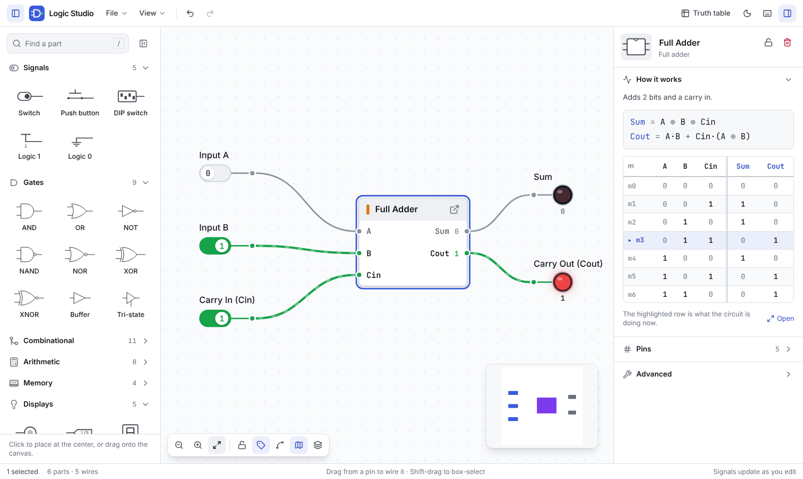
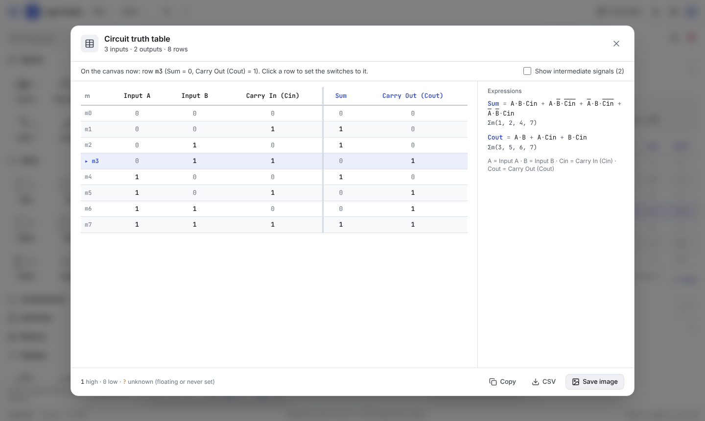
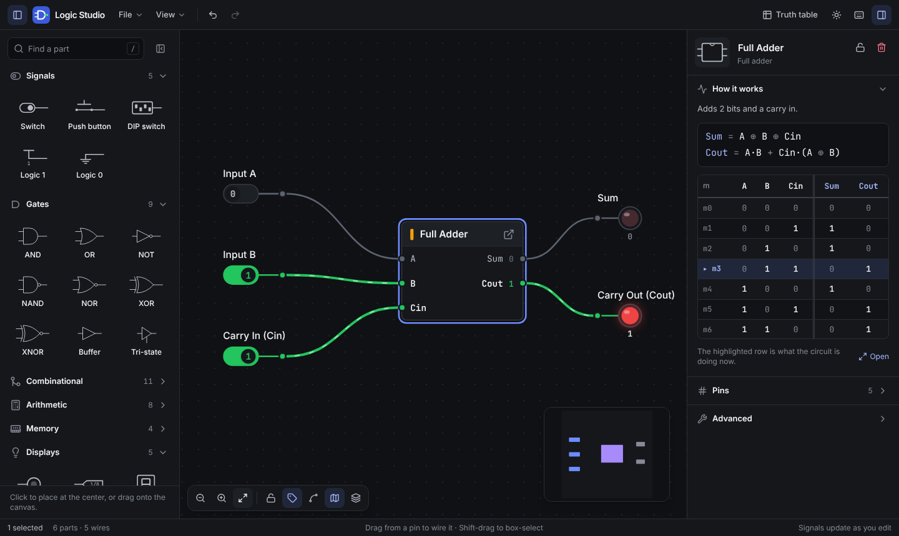

<div align="center">
  

  # Logic Studio

  **Build and simulate digital logic circuits in your browser.**

  Made for engineering students: place gates and chips, wire them up, flip switches and watch the signals change.
  Every circuit gets a truth table and simplified Boolean expressions. Free, no sign-up, and your work never leaves your computer.

  [](https://github.com/ldTaohid880/logic-studio/actions/workflows/ci.yml)
  [](LICENSE)
</div>

<p align="center"><strong><a href="https://logic-studio-gamma.vercel.app/">Try it now →</a></strong></p>



## What you can do

- **Build circuits** from 45 parts: switches, push buttons and DIP switches; AND, OR, NOT, NAND, NOR, XOR, XNOR, buffers and tri-state buffers; multiplexers, decoders, encoders, comparators and parity chips; adders and subtractors; latches, flip-flops and a 4-bit register; LEDs, probes, 7-segment and hex displays.
- **See signals live.** Wires and pins show 1, 0 or unknown as you edit. Unknown values are marked with `?`, hollow pins and dashed wires, so the state is readable without relying on colour.
- **Get the truth table of any circuit**, with the row matching the canvas highlighted. Click a row to set the switches to it. Each output gets a simplified sum-of-products expression and its minterm list.
- **Learn how each part works.** Select a part to see its expression and truth table in the inspector.
- **Spot feedback problems.** Circuits that never settle, such as a ring of inverters, are outlined and explained.
- **Make your own chips.** Turn a selection into a reusable component, open it to edit the inside, and nest components inside each other.
- **Start from examples** covering gates, adders, subtractors, multiplexers, a BCD decoder, latches and flip-flops.
- **Keep your work.** It autosaves in the browser. You can also save and open `.json` files (custom components included) and export the canvas as a PNG.
- **Use it your way:** light and dark themes, three interface sizes, and keyboard shortcuts for everything (press `?` in the app).

<table>
  <tr>
    <td></td>
    <td></td>
  </tr>
  <tr>
    <td align="center">Circuit truth table</td>
    <td align="center">Dark theme</td>
  </tr>
</table>

## Keyboard shortcuts

| Action | Keys |
| :-- | :-- |
| Undo / redo | `Ctrl+Z` / `Ctrl+Y` (or `Ctrl+Shift+Z`) |
| Copy, cut, paste, duplicate | `Ctrl+C`, `Ctrl+X`, `Ctrl+V`, `Ctrl+D` |
| Delete the selection | `Delete` |
| Group / ungroup | `Ctrl+G` / `Ctrl+Shift+G` |
| Save as JSON | `Ctrl+S` |
| Find a part | `/` |
| Show all shortcuts | `?` |

On a Mac, use `Cmd` instead of `Ctrl`. Drag from a pin to draw a wire, click a switch to toggle it, Shift-drag to box-select and right-click for the context menu.

## Running it locally

You need [Node.js](https://nodejs.org/) 18 or newer.

```bash
git clone https://github.com/ldTaohid880/logic-studio.git
cd logic-studio
npm install
npm run dev        # http://localhost:3000
```

| Command | What it does |
| :-- | :-- |
| `npm run dev` | Development server with hot reload |
| `npm test` | Unit tests (Vitest) |
| `npm run lint` | Type check (TypeScript, strict) |
| `npm run check` | Type check, tests and production build; run before opening a pull request |
| `npm run build` | Production bundle in `dist/`, ready for any static host |

The app is fully client-side, so there's no server or database to set up. Link previews use absolute URLs: `SITE_URL` if set (for example `SITE_URL=https://logic.example.com npm run build`), otherwise the Vercel production domain, otherwise the live demo address.

## How it's built

React 19 and TypeScript, the canvas from [React Flow](https://reactflow.dev/), state in [Zustand](https://zustand.docs.pmnd.rs/), styling with Tailwind CSS 4, built with Vite. The simulation engine (`src/simulation/`) is plain TypeScript with no React, and is covered by unit tests that check every chip against an independent reference model.

[`CLAUDE.md`](CLAUDE.md) is the developer guide: project layout, how the simulation works, store conventions and a checklist for adding a new part.

## Contributing

Issues and pull requests are welcome. Please run `npm run check` before opening a pull request, and keep interface text in sentence case and plain language.

## License

[MIT](LICENSE)
