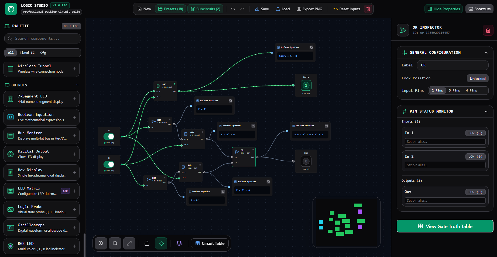

<div align="center">
  

  # ⚡ LOGIC STUDIO

  ### An Advanced, Interactive Web-Based Digital Logic Circuit Simulator
  
  [](LICENSE)
  [](https://react.dev/)
  [](https://vitejs.dev/)
  [](https://www.typescriptlang.org/)
  [](https://reactflow.dev/)
  [](https://tailwindcss.com/)
  
  **Logic Studio** is a modern, high-performance, and feature-rich digital logic circuit simulator designed for students, educators, and engineers. Built with a sleek dark theme and glassmorphic UI elements, it offers a real-time signal propagation engine on an infinite panning/zooming canvas. Create everything from simple logic gates to complex, hierarchical custom subcircuits.
</div>

---

## 📖 Table of Contents

1. [Features](#-features)
   - [Interactive Workspace](#1-interactive-workspace)
   - [Component Library](#2-component-library)
   - [Custom Subcircuits & Hierarchical Design](#3-custom-subcircuits--hierarchical-design)
   - [Integrated Analysis & Instrumentation](#4-integrated-analysis--instrumentation)
   - [User Experience & Aesthetics](#5-user-experience--aesthetics)
2. [Technology Stack](#-technology-stack)
3. [Getting Started](#%EF%B8%8F-getting-started)
   - [Prerequisites](#prerequisites)
   - [Installation](#installation)
   - [Running Locally](#running-locally)
   - [Building for Production](#building-for-production)
4. [Keyboard Shortcuts & Controls](#-keyboard-shortcuts--controls)
5. [Contributing](#-contributing)
6. [License](#-license)

---

## 🚀 Features

### 1. Interactive Workspace
* **Infinite Canvas**: Seamlessly pan, zoom, and navigate complex schematics using a canvas built on `@xyflow/react` (React Flow).
* **Real-time Signal Propagation**: Signals (HIGH `1`, LOW `0`, and Floating `-1`) propagate instantly through wires and components as you edit.
* **Smart Wiring**: Easily drag connections between pins. Click on wires to inspect their status or delete them.

### 2. Component Library
Logic Studio features an extensive library of modular components categorized for rapid logic design:

* **Logic Gates**: AND, OR, NOT, NAND, NOR, XOR, XNOR, Buffer, Tri-state Buffer (with configurable inputs).
* **Input Elements**:
  * **Clock**: Emits periodic pulses with adjustable frequency (in milliseconds).
  * **DIP Switches & Push Buttons**: Toggle states interactively.
  * **Constant Nodes**: Permanent HIGH (`1`) and LOW (`0`) sources.
* **Output & Visualization**:
  * **Logic Probe & RGB LED**: Immediate signal state indicators.
  * **7-Segment & Hex Display**: Visualize binary outputs as human-readable characters/numbers.
  * **Bus Monitor**: Debug multi-bit buses.
  * **Oscilloscope**: Visualize logic waveforms in real-time.
  * **LED Matrix**: Program matrix designs directly.
* **Combinational Circuits**:
  * Multiplexers/Demultiplexers (4-to-1, 8-to-1, 1-to-4, 1-to-8).
  * Encoders & Decoders (BCD-to-7-segment, Priority Encoders, 3-to-8, 4-to-16).
  * Parity Generators/Checkers.
  * Binary-to-Gray and Gray-to-Binary converters.
* **Sequential Elements**:
  * Latches & Flip-flops (D Latch, JK Flip-flop, T Flip-flop).
  * Registers (4-bit, Shift Register).
  * Counters (4-bit Up/Down, Ripple, Synchronous, Ring).
* **Arithmetic Units**:
  * Half Adder / Full Adder.
  * 4-bit Adders, Subtractors, and Adder-Subtractors.
  * 4-bit Incrementers & Decrementers.
  * 4-bit ALU (Arithmetic Logic Unit) supporting multiple operations.
* **Wiring & Utility**:
  * **Buses**: Joiners, Splitters, Taps, and Bit Extractors to manage multi-bit buses cleanly.
  * **Tunnels**: Wireless nodes that connect logic paths without cluttering the canvas with wires.
  * **Text Labels**: Annotate your circuit designs.

### 3. Custom Subcircuits & Hierarchical Design
* **Custom Component Wizard**: Package any group of components on the canvas into a reusable custom chip/subcircuit. Define custom input and output pin layouts, give it a name, and save it.
* **Subcircuit Library**: Keep a library of custom components and drag-and-drop them into parent canvases as nested nodes for complex hierarchical designs.

### 4. Integrated Analysis & Instrumentation
* **Truth Table Generator**: Generate the complete truth table for any circuit or subcircuit with one click.
* **Boolean Equation Generator**: View the derived boolean expressions representing the logic behavior of your circuit.
* **Interactive Inspector**: Highlight any wire or component to see its current state, pin names, descriptions, configuration variables, and custom parameters.

### 5. User Experience & Aesthetics
* **Premium Theme**: A stunning, modern dark theme complete with glassmorphic modals and glowing logic signals.
* **Keyboard Hotkeys**: Full undo/redo history, clipboard support (copy/cut/paste/duplicate), and hotkeys for lightning-fast editing.
* **Visual Export**: Export high-quality PNG snapshots of your circuits directly from the toolbar.

---

## 🛠️ Technology Stack

* **Frontend Framework**: [React 19](https://react.dev/)
* **Build Tool & Server**: [Vite 6](https://vite.dev/)
* **Programming Language**: [TypeScript](https://www.typescriptlang.org/)
* **Canvas Engine**: [React Flow (xyflow)](https://reactflow.dev/)
* **State Management**: [Zustand](https://zustand-demo.pmnd.rs/)
* **Styling**: [Tailwind CSS v4](https://tailwindcss.com/)
* **Icons**: [Lucide React](https://lucide.dev/)
* **Animations**: [Motion](https://motion.dev/)

---

## ⚙️ Getting Started

### Prerequisites
Make sure you have [Node.js](https://nodejs.org/) installed (v18+ recommended).

### Installation
1. Clone the repository:
   ```bash
   git clone https://github.com/your-username/digital-logic-simulator.git
   cd digital-logic-simulator
   ```

2. Install the project dependencies:
   ```bash
   npm install
   ```

### Running Locally
Start the development server:
```bash
npm run dev
```
Open your browser and navigate to `http://localhost:3000` to start building circuits!

### Building for Production
To build a highly optimized production bundle:
```bash
npm run build
```
This generates build artifacts in the `dist` folder, which can be deployed to Vercel, Netlify, or any static hosting service.

---

## ⌨️ Keyboard Shortcuts & Controls

Use these keyboard shortcuts to speed up your design and simulation workflow:

| Action | Shortcut / Control |
| :--- | :--- |
| **Copy Component** | `Ctrl + C` / `Cmd + C` |
| **Cut Component** | `Ctrl + X` / `Cmd + X` |
| **Paste Component** | `Ctrl + V` / `Cmd + V` |
| **Duplicate Component** | `Ctrl + D` / `Cmd + D` |
| **Delete Selected** | `Delete` / `Backspace` |
| **Undo Action** | `Ctrl + Z` / `Cmd + Z` |
| **Redo Action** | `Ctrl + Y` / `Cmd + Shift + Z` |
| **Toggle Input State** | Click interactively on INPUT / Switch / Button nodes |
| **Connect Pins** | Click & drag wire from any output pin to an input pin |
| **Inspect / Select Wire** | Left-click on any wire segment |
| **Zoom Canvas** | Scroll wheel up/out |
| **Pan Canvas** | Right-click + drag or Spacebar + drag |

---

## 🤝 Contributing

Contributions to Logic Studio are welcome! To contribute:
1. Fork the project.
2. Create a feature branch (`git checkout -b feature/AmazingFeature`).
3. Commit your changes (`git commit -m 'Add some AmazingFeature'`).
4. Push to the branch (`git push origin feature/AmazingFeature`).
5. Open a Pull Request.

---

## 📄 License

This project is licensed under the MIT License - see the [LICENSE](LICENSE) file for details.

